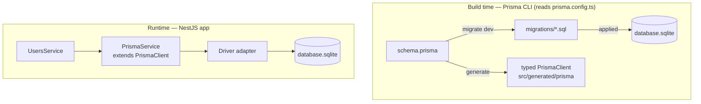

# h04 — NestJS + Prisma (Study Notes)

Practice repo from the PBKK course (H04): a simple blog API (**User** and **Post**) built with **NestJS 12**, **Prisma 7**, and **SQLite**.

These notes focus on **concepts**, so I can re-learn the ideas quickly. For actual code, read the source files listed in [Where to look](#7-where-to-look).

## Contents

1. [Run it](#1-run-it)
2. [What is Prisma](#2-what-is-prisma)
3. [Build time vs runtime](#3-build-time-vs-runtime)
4. [The building blocks](#4-the-building-blocks)
5. [How Prisma fits into NestJS](#5-how-prisma-fits-into-nestjs)
6. [Pitfalls](#6-pitfalls)
7. [Where to look](#7-where-to-look)
8. [Status of this repo](#8-status-of-this-repo)

---

## 1. Run it

```bash
pnpm install
# create .env with:  DATABASE_URL="file:./database.sqlite"
pnpm prisma migrate dev     # create tables from the migrations
pnpm prisma generate        # build the typed client
pnpm run start:dev          # http://localhost:3000
```

`.env` is gitignored and the generated client is not committed, so both have to be created after cloning. Order matters: **generate the client before compiling**, because the app imports from it.

---

## 2. What is Prisma

> **One schema. Every query type-safe.**

A type-safe ORM for TypeScript. You describe the data model **once** in a schema file, and Prisma produces a typed client from it.

| Feature          | What it means                                                        |
| ---------------- | -------------------------------------------------------------------- |
| **Schema**       | One file for models, types, and relations                            |
| **Client**       | Generated, so a wrong field name fails in the editor, not at runtime |
| **Migrations**   | Tracked SQL files; the history of the database                       |
| **Any database** | PostgreSQL, MySQL, SQLite, MongoDB, …                                |

**The schema is the single source of truth.** Both the database and the TypeScript types derive from it. In TypeORM that role belongs to the entity _class_; in Prisma it belongs to the schema _file_.

---

## 3. Build time vs runtime

The idea that confuses me most: Prisma lives in **two separate worlds**.



|           | Build time                           | Runtime                            |
| --------- | ------------------------------------ | ---------------------------------- |
| **Who**   | The Prisma CLI                       | The NestJS app                     |
| **Reads** | `prisma.config.ts`                   | The adapter inside `PrismaService` |
| **Does**  | Creates tables, generates the client | Runs queries                       |

The daily loop:

> edit `schema.prisma` → `migrate dev` → `generate` → use it in a service

**Every time the schema changes, run both `migrate dev` and `generate` again.** `migrate dev` updates the database; `generate` updates the TypeScript types. They are independent, and forgetting either one gives confusing errors.

---

## 4. The building blocks

### `schema.prisma`: what the data looks like

Describes tables, columns, and relations in one place. The syntax is small:

| Syntax                                              | Meaning                                         |
| --------------------------------------------------- | ----------------------------------------------- |
| `String?`                                           | nullable                                        |
| `@id`                                               | primary key                                     |
| `@unique`                                           | no duplicates allowed                           |
| `@default(...)`                                     | value used when none is given                   |
| `@updatedAt`                                        | timestamp refreshed automatically on update     |
| `Post[]` on one side, `@relation(...)` on the other | a **1-to-N** relation (one user has many posts) |

The relation is stored as a **foreign key** (`authorId` on Post). In the schema it looks like a property (`author`, `posts`); in the database it is just that one column.

### `prisma.config.ts`: how the CLI connects

Tells the CLI where the schema and migrations are, and which database to use (`DATABASE_URL`).

- In **Prisma 7** the database URL is **not** in `schema.prisma` any more. It lives here.
- The file must be named exactly `prisma.config.ts`, otherwise the CLI will not find it.
- Only the CLI reads it. The running app does not.

### Migrations: the history of the database

`migrate dev` compares the schema with the database, writes the difference as a **plain SQL file**, and applies it.

- Folder name = **timestamp + the `--name` you gave**.
- `@unique` becomes a unique index; a relation becomes a foreign key.
- **Commit the migrations folder.** It is how someone else (or future me) rebuilds the same database.

### Generated client: the typed API

`generate` writes a client into `src/generated/prisma`. This is what makes `prisma.user.create(...)` autocomplete and type-check every field. It is output, not source, so it is not committed.

### Driver adapter: the actual connection

Prisma 7 needs a **driver adapter** to talk to the database. Here it is `better-sqlite3`, which contains native code, so pnpm must be explicitly allowed to build it (`allowBuilds` in `pnpm-workspace.yaml`).

---

## 5. How Prisma fits into NestJS

### Why `PrismaService` exists

`PrismaClient` is not a Nest provider, so it cannot be injected as it is. `PrismaService` **wraps it**: a class that extends `PrismaClient` and is marked injectable.

- Because it _extends_ `PrismaClient`, services use it directly: `this.prisma.user...`
- It builds the **adapter** from `DATABASE_URL`, so the app knows how to reach the database.
- It connects when the module starts (the `onModuleInit` hook, same idea as W03).
- Nest does **not** load `.env` by itself, so `dotenv` has to do it.

### Modules and sharing

A provider is only available to modules that list it. So `PrismaService` must be in `providers` of **every module that uses it**.

The cleaner pattern is a single **`PrismaModule`** that _exports_ `PrismaService`, imported wherever needed. One instance, and no module can forget to register it. **This repo uses that pattern:** `UsersModule` and `PostsModule` both import `PrismaModule`.

### Querying

| Method       | Meaning                                  |
| ------------ | ---------------------------------------- |
| `create`     | INSERT, returns the new row              |
| `findMany`   | SELECT many rows                         |
| `findUnique` | One row by a unique field, or **`null`** |
| `update`     | UPDATE; **throws** if the row is missing |
| `delete`     | DELETE; **throws** if the row is missing |
| `include`    | Load a relation too (a join)             |

Note the asymmetry: **`findUnique` returns `null`** for a missing row, but **`update` and `delete` throw**. A "404 Not Found" never happens automatically; it has to be written on purpose.

### Relations in practice

Creating a post needs an **`authorId`** in the request body; that is what links it to a user. An `authorId` that does not exist is rejected by the database (foreign key error). Adding `include` on a query nests the related object in the result (a post comes back with its `author`).

### DTOs

A **DTO** describes the shape of a request body.

- It must have real fields. An empty class does not match Prisma's input type, so TypeScript rejects it.
- The update DTOs are built with `PartialType`, which makes every field **optional**. This suits `PATCH`, where only some fields are sent.

### Strict ValidationPipe

Enabled globally in `main.ts` with three options:

| Option                 | Effect                                                      |
| ---------------------- | ----------------------------------------------------------- |
| `transform`            | Plain JSON becomes a real DTO instance                      |
| `whitelist`            | Properties **without a validation decorator** are removed   |
| `forbidNonWhitelisted` | Instead of removing them silently, the request gets **400** |

The catch: "whitelisted" means _"has a class-validator decorator"_. A DTO whose fields have no decorators looks empty to the pipe, and every property counts as forbidden.

---

## 6. Pitfalls

| Symptom                                               | Cause                                                | Fix                                                                           |
| ----------------------------------------------------- | ---------------------------------------------------- | ----------------------------------------------------------------------------- |
| Cannot find `./generated/prisma/client`               | Client was never generated                           | `pnpm prisma generate`                                                        |
| TS: DTO "is not assignable to … CreateInput"          | DTO is an empty class                                | Give it fields matching the model                                             |
| `this.prisma.findMany` does not exist                 | Forgot the model name                                | `this.prisma.user.findMany`                                                   |
| Types or tables out of date after editing the schema  | Only one of the two steps was run                    | `migrate dev` **and** `generate`                                              |
| Nest "can't resolve dependencies"                     | Module does not provide `PrismaService`              | Register it, or use a shared `PrismaModule`                                   |
| Missing record gives status 200 and empty body        | `findUnique` returned `null`                         | Throw `NotFoundException` yourself                                            |
| `PATCH`/`DELETE` of a missing id gives 500            | Prisma threw an error                                | Handle it, or check existence first (this repo calls `findOne` first)         |
| Renaming a field makes Prisma want to drop the column | Prisma sees a rename as drop + add, which loses data | `migrate dev --create-only`, then edit the SQL to `RENAME COLUMN`, then apply |
| Error about a foreign key on creating a post          | `authorId` does not exist                            | Create the user first                                                         |
| `better-sqlite3` fails to load                        | pnpm did not run its build script                    | `allowBuilds` in `pnpm-workspace.yaml`                                        |
| `DATABASE_URL` undefined at runtime                   | Nest does not read `.env`                            | Load `dotenv`                                                                 |
| CLI ignores the config                                | File is not named `prisma.config.ts`                 | Rename it                                                                     |
| Red errors in VS Code but `tsc` passes                | Stale TypeScript server                              | _TypeScript: Restart TS Server_                                               |

When in doubt, trust the terminal over the editor: `npx tsc --noEmit` and `pnpm run lint`.

---

## 7. Where to look

| I want to see…                     | File                                     |
| ---------------------------------- | ---------------------------------------- |
| The data model                     | `prisma/schema.prisma`                   |
| How the CLI is configured          | `prisma.config.ts`                       |
| The generated SQL                  | `prisma/migrations/`                     |
| The Nest wrapper around Prisma     | `src/prisma.service.ts`                  |
| How it is shared between modules   | `src/prisma.module.ts`                   |
| Basic CRUD with Prisma             | `src/users/users.service.ts`             |
| A relation (`authorId`, `include`) | `src/posts/posts.service.ts`             |
| Request body shapes                | `src/*/dto/`                             |
| Validation setup                   | `src/main.ts`                            |
| Module wiring                      | `src/app.module.ts`, `src/*/*.module.ts` |

Endpoints follow REST on two resources, `/users` and `/posts`: `POST`, `GET` (all and by id), `PATCH`, and `DELETE`. `GET` on users includes their posts; `GET` on posts includes the author.
