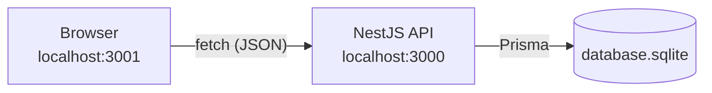

# h06 — Posts App (NestJS API + Next.js Frontend)

Practice project from the PBKK course (H06): a small blog where **users** write **posts**.
It is split into two apps that run side by side:

| Folder                                       | What it is                                   | Port   |
| -------------------------------------------- | -------------------------------------------- | ------ |
| [`nestjs-public-posts/`](nestjs-public-posts) | REST API — NestJS 12 + Prisma 7 + SQLite     | `3000` |
| [`nextjs-public-posts/`](nextjs-public-posts) | Web UI — Next.js 16 (Pages Router) + Bootstrap | `3001` |



The frontend renders in the browser and calls the API directly with `fetch`. The API only accepts browser requests from the frontend's origin (CORS).

## Contents

1. [Requirements](#1-requirements)
2. [First-time setup](#2-first-time-setup)
3. [Running the app](#3-running-the-app)
4. [Configuration](#4-configuration)
5. [API reference](#5-api-reference)
6. [Frontend pages](#6-frontend-pages)
7. [Project structure](#7-project-structure)
8. [Scripts](#8-scripts)
9. [Troubleshooting](#9-troubleshooting)

---

## 1. Requirements

- **Node.js** 22 or newer (developed on Node 26)
- **pnpm** 12 — `npm install -g pnpm`

## 2. First-time setup

### Backend

```bash
cd nestjs-public-posts
pnpm install

# .env is gitignored, so create it:
echo 'DATABASE_URL="file:./database.sqlite"' > .env

pnpm prisma migrate dev     # create the tables from prisma/migrations
pnpm prisma generate        # build the typed Prisma client into src/generated/prisma
```

Generate the client **before** building or starting the backend, because the app imports from it.

### Frontend

```bash
cd nextjs-public-posts
pnpm install
```

No `.env` is needed for local development; the API URL defaults to `http://localhost:3000`.

### Create the first user

A post must belong to an author, so the **New Post** form stays disabled until at least one user exists.
With the backend running (see below), create one:

```bash
curl -X POST http://localhost:3000/users \
  -H "Content-Type: application/json" \
  -d '{"name":"Your Name","email":"you@example.com"}'
```

> On Windows PowerShell, use `curl.exe` and escape the inner quotes:
> `-d "{\"name\":\"Your Name\",\"email\":\"you@example.com\"}"`

## 3. Running the app

Use two terminals and start the backend first:

```bash
# Terminal 1 — API on http://localhost:3000
cd nestjs-public-posts
pnpm run start:dev
```

```bash
# Terminal 2 — UI on http://localhost:3001
cd nextjs-public-posts
pnpm dev
```

Then open **http://localhost:3001**.

For a production run, build each app first: `pnpm run build`, then `pnpm run start:prod` (backend) and `pnpm start` (frontend).

## 4. Configuration

| Variable              | App      | Default                  | Purpose                                                       |
| --------------------- | -------- | ------------------------ | ------------------------------------------------------------- |
| `DATABASE_URL`        | backend  | — (required)             | SQLite file, e.g. `file:./database.sqlite`                    |
| `PORT`                | backend  | `3000`                   | Port the API listens on                                       |
| `FRONTEND_URL`        | backend  | `http://localhost:3001`  | Origins allowed by CORS; comma-separated for several          |
| `NEXT_PUBLIC_API_URL` | frontend | `http://localhost:3000`  | Base URL of the API (put it in `nextjs-public-posts/.env.local`) |

If you change a port, update the matching variable in the other app too.

## 5. API reference

Base URL: `http://localhost:3000`. All bodies are JSON (`Content-Type: application/json`).

### Posts

| Method   | Path         | Body                                        | Success |
| -------- | ------------ | ------------------------------------------- | ------- |
| `GET`    | `/posts`     | —                                           | `200` list, newest first, with `author` |
| `GET`    | `/posts/:id` | —                                           | `200` one post with `author` |
| `POST`   | `/posts`     | `title`, `content`, `authorId`, `published?` | `201` created post |
| `PUT`    | `/posts/:id` | any subset of the fields above              | `200` updated post |
| `DELETE` | `/posts/:id` | —                                           | `200` deleted post |

### Users

| Method   | Path         | Body                       | Success |
| -------- | ------------ | -------------------------- | ------- |
| `GET`    | `/users`     | —                          | `200` list with each user's `posts` |
| `GET`    | `/users/:id` | —                          | `200` one user with `posts` |
| `POST`   | `/users`     | `name`, `email`, `bio?`    | `201` created user |
| `PATCH`  | `/users/:id` | any subset of the fields above | `200` updated user |
| `DELETE` | `/users/:id` | —                          | `200` deleted user |

`GET /` redirects to `/posts`.

### Validation rules

- `title` and `content` are required, trimmed, and must not be blank; `title` is at most 200 characters.
- `authorId` must be the id of an existing user.
- `email` must be a valid, unique email address.
- Fields that are not listed above (for example `id` or `createdAt`) are rejected.
- `:id` in the path must be a number.

### Error responses

Errors come back as JSON with a `statusCode` and a `message` (a string, or an array of strings for validation errors):

```json
{ "statusCode": 400, "error": "Bad Request", "message": ["title should not be empty"] }
```

| Status | When                                                                    |
| ------ | ----------------------------------------------------------------------- |
| `400`  | Invalid body or id, unknown `authorId`, or deleting a user who still has posts |
| `404`  | Post or user not found                                                  |
| `409`  | Email already used by another user                                      |
| `500`  | Unexpected server error (details are logged on the server only)         |

## 6. Frontend pages

| Route              | Page                                                          |
| ------------------ | ------------------------------------------------------------- |
| `/`                | All posts, with View / Edit / Delete buttons                  |
| `/posts/new`       | Form to create a post (title, content, author, published)     |
| `/posts/[id]`      | Post details and Delete                                       |
| `/posts/[id]/edit` | Form to edit a post                                           |

Validation messages from the API are shown above the form.

## 7. Project structure

```
h06-lecture/
├── nestjs-public-posts/
│   ├── prisma/
│   │   ├── schema.prisma          # User and Post models
│   │   └── migrations/            # SQL history of the database
│   ├── src/
│   │   ├── main.ts                # CORS, global ValidationPipe, port
│   │   ├── common/
│   │   │   ├── prisma-error.handler.ts   # Prisma error -> HTTP status
│   │   │   └── trim.transform.ts         # @Trim() for DTO strings
│   │   ├── posts/                 # controller, service, DTOs
│   │   ├── users/                 # controller, service, DTOs
│   │   └── prisma.service.ts      # PrismaClient with the SQLite adapter
│   └── test/                      # e2e tests
└── nextjs-public-posts/
    └── src/
        ├── lib/api.ts             # API URL, Post/User types, error helpers
        ├── components/PostForm.tsx  # form shared by new and edit pages
        └── pages/                 # index, posts/new, posts/[id], posts/[id]/edit
```

More notes on Prisma and NestJS are in [`nestjs-public-posts/README.md`](nestjs-public-posts/README.md).

## 8. Scripts

| Where    | Command               | Does                                   |
| -------- | --------------------- | -------------------------------------- |
| backend  | `pnpm run start:dev`  | Start the API with auto-reload         |
| backend  | `pnpm run build`      | Compile to `dist/`                     |
| backend  | `pnpm run lint`       | Lint with oxlint                       |
| backend  | `pnpm test`           | Unit tests                             |
| backend  | `pnpm run test:e2e`   | End-to-end tests                       |
| backend  | `pnpm prisma studio`  | Browse the database in the browser     |
| frontend | `pnpm dev`            | Start the UI on port 3001              |
| frontend | `pnpm run build`      | Production build                       |
| frontend | `pnpm lint`           | Lint with ESLint (`pnpm lint --fix` to auto-fix) |

## 9. Troubleshooting

| Problem                                                         | Fix |
| --------------------------------------------------------------- | --- |
| Home page shows **"Failed to fetch"**                           | The backend is not running, or runs on a different port than `NEXT_PUBLIC_API_URL`. |
| Browser console shows a **CORS** error                          | Open the UI at exactly `http://localhost:3001`, or add your origin to `FRONTEND_URL`. |
| **New Post** says *"No users yet"*                              | Create a user first — see [Create the first user](#create-the-first-user). |
| Backend fails with `Cannot find module './generated/prisma/client'` | Run `pnpm prisma generate` in `nestjs-public-posts`. |
| Backend errors about a missing table or column                  | Run `pnpm prisma migrate dev` in `nestjs-public-posts`. |
| `EADDRINUSE` when starting                                      | Another process is using port 3000 or 3001; stop it or change the port. |
